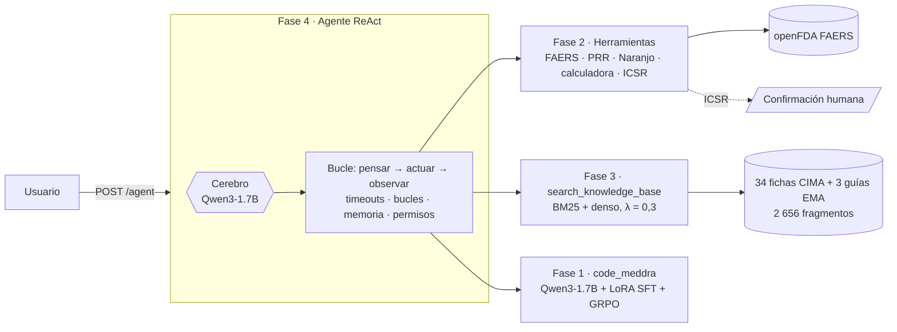

# ARCA · Agente de farmacovigilancia

**Un agente que codifica notificaciones de reacciones adversas en MedDRA, consulta fichas técnicas
y datos de FAERS, calcula señales de desproporcionalidad y prepara el ICSR, con un humano que
confirma antes de registrar nada.**

Práctica final de Modelos Generativos Profundos · Máster en Inteligencia Artificial · ICAI ·
2026-2027. Equipo: Matteo Ferrari, Pedro Meseguer y Mario Alonso. Todo con modelos abiertos pequeños (Qwen3-1.7B) entrenados y evaluados en una GPU de
16 GB. El enunciado de la práctica está en [`docs/practica.md`](docs/practica.md).

## Para quién y qué problema resuelve

Un técnico de farmacovigilancia de un centro autonómico recibe notificaciones en lenguaje
natural ("llevo una semana con sertralina y me da muchísimo sueño") y tiene que:

1. **Codificarlas** en *Preferred Terms* de MedDRA aplicando las reglas de *Term Selection: Points
   to Consider* (lo negado no se codifica, el diagnóstico absorbe sus síntomas, la muerte es un
   desenlace…).
2. **Comprobar** en la ficha técnica si la reacción es conocida y con qué frecuencia.
3. **Mirar** cuántas notificaciones hay en FAERS y si hay señal (PRR, regla de Evans).
4. **Valorar** la causalidad (algoritmo de Naranjo) y **registrar** el caso (ICSR).

Hoy eso son cuatro pestañas, un diccionario con licencia y una hoja de cálculo. ARCA lo resuelve
en una petición, y deja el registro pendiente de que una persona lo confirme.

## Ejemplo real (agente, cerebro `base`, del banco de evaluación)

> *Mira en la ficha técnica si el edema periférico es una reacción conocida del amlodipino y
> calcula su PRR en FAERS.*

| Paso | Acción | Observación (real) |
|---|---|---|
| 1 | `search_knowledge_base("Is peripheral edema a known adverse reaction of amlodipine?")` | `[1d381329ee-0023]` Ficha técnica de amlodipino, 4.8 Reacciones adversas … |
| 2 | `faers_reaction_counts(drug="amlodipino", reaction="Oedema peripheral")` | 8 358 notificaciones con el fármaco y la reacción, de 434 733 con amlodipino (openFDA) |
| 3 | `disproportionality_prr(8358, 434733, 122014, 21054159)` | PRR 3,49 (IC 95 % 3,41–3,57), **señal** según Evans |
| 4 | `final_answer(…)` | "El PRR del edema periférico con amlodipino en FAERS es 3,49 … señal significativa" |

El agente normaliza "amlodipino" a "amlodipine", copia los recuentos de FAERS al PRR sin
tocarlos y no inventa ningún número. La traza completa (pensamientos incluidos) la devuelve
`POST /agent`, y `uv run python -m agent.ui` la muestra en un visor.

## Arquitectura



| Fase | Qué es | Endpoint | Carpeta |
|---|---|---|---|
| 1 · Razonamiento | Codificación MedDRA: destilación de Qwen3-4B → SFT → GRPO con tres recompensas verificables, sobre Qwen3-1.7B con LoRA | `POST /reasoning` | [`rlm/`](rlm/) |
| 2 · Herramientas | 5 herramientas tipadas con Pydantic (FAERS en vivo, PRR, Naranjo, calculadora segura, ICSR con confirmación) y el bucle de tool use escrito a mano | `POST /tools` | [`tool_use/`](tool_use/) |
| 3 · Conocimiento | RAG sobre fichas técnicas de CIMA y guías de la EMA: troceado recursivo, BM25, Qwen3-Embedding-0.6B, híbrido y respuestas con citas verificadas | `POST /rag` | [`rag/`](rag/) |
| 4 · Agente | Harness ReAct propio: una acción por paso, timeouts, recuperación de errores, detección de bucles, memoria con resumen, confirmación humana, tres cerebros intercambiables; y un agente de código (smolagents) para comparar | `POST /agent` | [`agent/`](agent/) |

Decisiones y alternativas descartadas, fase a fase, en la [guía del proyecto](docs/guia/README.md).

## Resultados

Todas las cifras son de conjuntos de **test** que no se usaron para tomar decisiones.

**Fase 1 · Codificación MedDRA** (pass@1 = conjunto exacto de PT, decodificación greedy)

| Modelo (Qwen3-1.7B) | Test (200) | Fuera de distribución (100, términos nunca vistos) |
|---|---|---|
| Base | 18,5 % | 14 % |
| + SFT (821 trazas destiladas y verificadas) | 51,5 % | 30 % |
| **+ SFT + GRPO** | **56,5 %** | **38 %** |

Ablaciones de GRPO: sin la recompensa de dominio, 53,0 %; con crédito parcial (F1), 55,0 %.
McNemar: SFT frente a base, p < 0,001; GRPO frente a SFT, p = 0,11 (tendencia, no significativo con 200
problemas). Detalle en [`rlm/RESULTADOS.md`](rlm/RESULTADOS.md).

**Fase 2 · Herramientas** (30 casos): selección de herramienta 1,00 · argumentos 0,83 ·
respuesta correcta **0,67 con herramientas frente a 0,33 sin ellas** · 6/6 preguntas que no
necesitan herramienta respondidas sin llamar a ninguna. [`tool_use/RESULTADOS.md`](tool_use/RESULTADOS.md)

**Fase 3 · RAG** (100 preguntas de test)

| Retriever | Hit@5 | MRR |
|---|---|---|
| BM25 | 0,66 | 0,530 |
| Denso | **0,90** | 0,684 |
| **Híbrido (λ = 0,3)** | 0,86 | **0,716** |

Generación con citas (Qwen3-1.7B): 68 % de respuestas citadas y 15 % de abstenciones falsas. Con
Qwen3-4B como generador, sobre la misma recuperación, 97 % y 3 %, y se abstiene en las 8 preguntas
sin respuesta: el cuello de botella era el generador. [`rag/RESULTADOS.md`](rag/RESULTADOS.md)

**Fase 4 · Agente** (20 tareas que encadenan de 2 a 3 herramientas, 2 de ellas imposibles)

| Agente | Cerebro | Éxito | Tokens por tarea |
|---|---|---|---|
| ReAct (JSON) | `thinking` (por defecto) | **65 %** | 10 849 |
| ReAct (JSON) | `base` | 55 % | 9 868 |
| ReAct (JSON) | `rlm` (LoRA de la fase 1) | 10 % | 3 274 |
| Código (smolagents) | `thinking` / `base` | 30 % / 20 % | ~28 000 |

El modelo de la fase 1 como cerebro olvida el protocolo de herramientas (escribe la traza entera
con observaciones inventadas), así que entra en el agente como herramienta. El agente de código
gana en las tareas de cálculo, pero gasta casi el triple de tokens y pierde en el resto.
[`agent/RESULTADOS.md`](agent/RESULTADOS.md)

Las acciones con efecto (el ICSR) quedan retenidas hasta que una persona las confirma
(`POST /agent/confirm`); entonces el agente retoma la conversación y explica el resultado.

Lo que no funciona, sin adornos: **las tareas imposibles** solo a medias ("¿cuántas notificaciones
hubo en España en 2025?" → `thinking` ya dice que no hay datos de España, pero copia mal el total
mundial; `base` lo da sin más), el modelo responde a menudo en inglés, y con 20 tareas el ruido es
de unos ±20 puntos. El cuaderno completo, fechado, está en [`EXPERIMENTS.md`](EXPERIMENTS.md).

## Cómo ejecutarlo

Requisitos: Python 3.11, [`uv`](https://docs.astral.sh/uv/) y una GPU NVIDIA con ≥ 12 GB para
servir las cuatro fases a la vez (en 8 GB caben de una en una).

```bash
git clone <este repositorio> && cd dgm-arca
cp .env.example .env              # el adaptador de la fase 1 se descarga del Hub
uv sync --extra train --extra rag --extra agent
uv run pytest                     # tests en verde
uv run python -m rag.download_corpus   # corpus: fichas de CIMA y guías de la EMA (~10 min)
uv run arca-api                   # http://localhost:8000/docs
```

Con Docker (driver de NVIDIA y `nvidia-container-toolkit` en la máquina):

```bash
cp .env.example .env
docker compose up api             # http://localhost:8000/docs
```

Si el corpus no está descargado, `/rag` lo descarga la primera vez que se le llama. El adaptador
LoRA de la fase 1 está en Hugging Face Hub:
[`Matteofermar/arca-meddra-qwen3-1.7b`](https://huggingface.co/Matteofermar/arca-meddra-qwen3-1.7b).

Peticiones de ejemplo:

```bash
curl -s localhost:8000/health
curl -s localhost:8000/reasoning -H 'Content-Type: application/json' \
  -d '{"question": "Llevo dos semanas con sertralina y me da muchísimo sueño. No he tenido náuseas."}'
curl -s localhost:8000/rag -H 'Content-Type: application/json' \
  -d '{"question": "¿Con qué frecuencia produce somnolencia la sertralina?", "retriever": "hybrid"}'
curl -s localhost:8000/agent -H 'Content-Type: application/json' \
  -d '{"task": "¿Hay señal de somnolencia con sertralina en FAERS? Calcula el PRR.", "brain": "base"}'
```

## Reproducir los resultados

| Fase | Comandos | Dónde |
|---|---|---|
| 1 | `make rlm-data rlm-distill rlm-sft rlm-grpo rlm-eval rlm-ablations` | GPU de 16 GB (DGX) |
| 2 | `make tools-eval` | GPU |
| 3 | `make rag-corpus rag-eval-gen` (desarrollo) y `make rag-test` (test, una sola vez) | GPU |
| 4 | `make agent-eval` | GPU |
| Todo lo pesado en una sesión | `bash scripts/dgx_session.sh` | DGX |

Los pesos, el índice y el corpus no están en el repositorio: los scripts anteriores los regeneran
(y el adaptador final está en el Hub). Los informes JSON y las gráficas de cada evaluación están en
[`reports/`](reports/).

## Estructura

```
rlm/        fase 1: dataset MedDRA, verificador, destilación, SFT, GRPO, evaluación, inferencia
tool_use/   fase 2: registro de herramientas, parser, bucle de tool use, banco de 30 casos
rag/        fase 3: descarga del corpus, troceado, embeddings, retrievers, generación con citas
agent/      fase 4: bucle ReAct, agente de código, memoria, banco de 20 tareas, visor de trazas
common/     el modelo de chat compartido por las fases 2, 3 y 4
api/        FastAPI: /health, /reasoning, /tools, /rag, /agent (contratos en api/schemas.py)
docs/guia/  guía del proyecto: una por fase, API e infraestructura, glosario
reports/    resultados de todas las evaluaciones (JSON y PNG)
```

## Licencia y datos

Código bajo licencia MIT. MedDRA es una terminología con licencia de la MSSO: el repositorio solo
incluye un subconjunto propio de 90 PT con fines docentes y un cargador para los ficheros
oficiales (`ARCA_MEDDRA_DIR`). Las fichas técnicas proceden de CIMA (AEMPS) y las guías de la EMA
se reproducen citando su origen; ninguna se redistribuye en el repositorio. FAERS se consulta en
vivo a través de openFDA.
