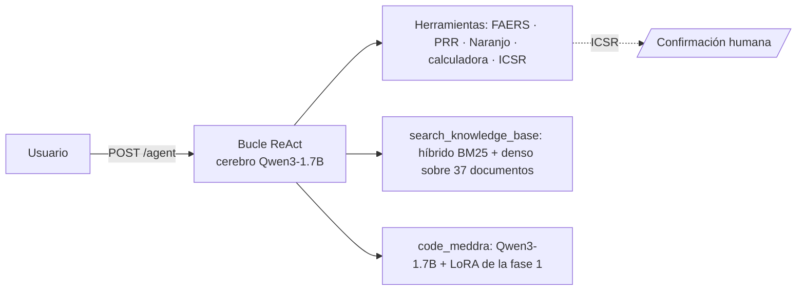
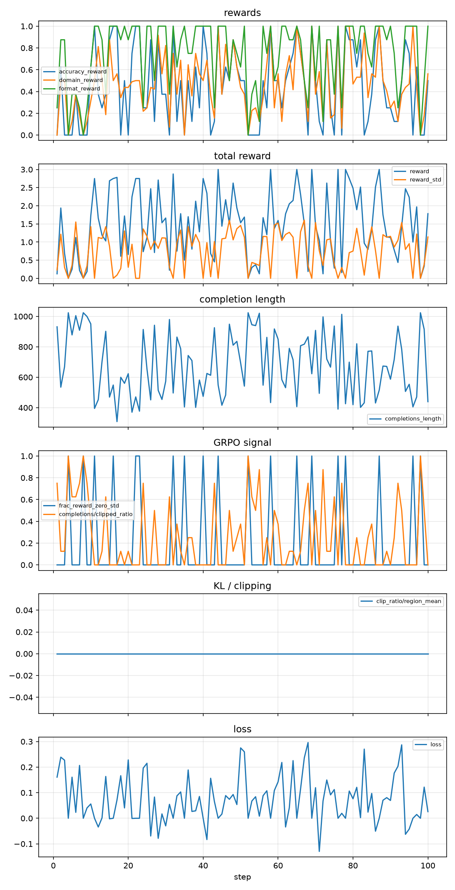

# ARCA · Agente de farmacovigilancia — informe técnico

Práctica final de Modelos Generativos Profundos · MIA · ICAI · 2026-2027.
Equipo: Matteo Ferrari, Pedro Meseguer y Mario Alonso.
Repositorio, API y cuaderno de experimentos: ver los anexos.

## 1. El problema y el usuario

El usuario es un técnico de un centro autonómico de farmacovigilancia. Recibe notificaciones
de sospechas de reacciones adversas escritas por pacientes, familiares o profesionales, en
lenguaje natural y en español, y para cada una tiene que: codificar las reacciones en *Preferred
Terms* (PT) de MedDRA siguiendo las reglas de *MedDRA Term Selection: Points to Consider*;
comprobar en la ficha técnica si la reacción es conocida y con qué frecuencia; consultar las
bases de notificaciones (FAERS) y calcular si hay señal de desproporcionalidad; valorar la
causalidad (Naranjo); y registrar el caso como ICSR. Hoy lo hace con el navegador de MedDRA, CIMA,
la web de openFDA y una hoja de cálculo.

ARCA lo resuelve con un agente. Ejemplo real del banco de evaluación (cerebro `base`):

> *Mira en la ficha técnica si el edema periférico es una reacción conocida del amlodipino y
> calcula su PRR en FAERS (Oedema peripheral).*

1. `search_knowledge_base` → fragmento `[1d381329ee-0023]`, sección 4.8 de la ficha de amlodipino.
2. `faers_reaction_counts(drug="amlodipino", reaction="Oedema peripheral")` → la herramienta
   normaliza a "amlodipine": 8 358 notificaciones con el fármaco y la reacción, de 434 733 con el
   fármaco, 122 014 con la reacción y 21 054 159 en total.
3. `disproportionality_prr` con esos cuatro números → PRR 3,49 (IC 95 % 3,41–3,57), señal según
   la regla de Evans.
4. `final_answer`: "El PRR del edema periférico con amlodipino en FAERS es 3,49 … señal".

Ningún número de la respuesta sale del modelo: todos son observaciones de herramientas.

## 2. Arquitectura

Las cuatro fases se sirven desde un solo proceso FastAPI en una GPU de 16 GB, y por eso todo
gira alrededor de **Qwen3-1.7B**: es el alumno de la fase 1, el modelo que decide las llamadas de
la fase 2, el generador del RAG y los tres cerebros del agente. Un único `ChatModel` compartido
(`common/llm.py`) evita cargar el mismo modelo tres veces. Qwen3 es híbrido: con
`enable_thinking=False` responde directamente, que es lo que queremos en RAG y en herramientas.

Decisiones principales y alternativas descartadas:

| Decisión | Alternativa descartada | Por qué |
|---|---|---|
| Alumno de 1,7B en la fase 1 | 0,6B (primera versión) | 0,6B no generaliza: 0–12 % fuera de distribución (sección 3) |
| Dataset sintético con generador programático | Notificaciones reales anotadas | No hay corpus público anotado con MedDRA, y MedDRA tiene licencia |
| Subconjunto propio de 90 PT | Distribuir MedDRA | Licencia de la MSSO; hay un cargador para los ficheros oficiales |
| Herramientas sobre openFDA en vivo | Datos descargados | Los recuentos cambian; el agente debe usar el dato real |
| Una acción por paso en el agente | Ejecutar todas las llamadas del paso | El modelo respondía antes de ver las observaciones (sección 6) |
| ICSR retenido para confirmación humana | Ejecutarlo | En la fase 2 el modelo inventó una edad para pasar una validación |
| Modelo de la fase 1 como herramienta | Como cerebro del agente | Como cerebro olvida el protocolo (sección 6) |

## 3. Fase 1: razonamiento (codificación MedDRA)

**Tarea y verificador.** Entrada: notificación en español más las cinco reglas de codificación.
Salida: `<think>…</think><answer>PT; PT</answer>`. El verificador (`MedDRAVerifier`) compara
conjuntos de PT después de mapear sinónimos aceptados (`Xerostomia` → `Dry mouth`); un término de
más, uno de menos o uno inexistente es un fallo. No juzga el razonamiento, solo el conjunto.

**Dataset.** Generador programático (`rlm/generate_meddra.py`) con cinco familias que obligan a
razonar con las reglas: `single`, `multi`, `diagnosis` (el diagnóstico absorbe sus síntomas
típicos), `death` (la muerte es un desenlace: se codifica la causa) y `lack_of_effect`. Añade
distractores (indicación, antecedentes, síntomas negados) y siete canales de notificación. Train
1 000, test 200 disjunto por parámetros, y un **OOD** de 100 problemas, cada uno con al menos uno
de 14 PT que no aparecen nunca en train ni en test.

**Destilación.** Profesor Qwen3-4B en modo thinking, 400 problemas × 4 trazas, filtradas con el
verificador: se aceptan 821 de 1 600 (51 %). La aceptación va del 65 % en `single` al 37 % en
`diagnosis`: el profesor también falla las reglas difíciles, y eso limita lo que el SFT puede
enseñar en esa familia.

**SFT y GRPO.** LoRA de rango 16 (α 32) en los dos. SFT: 2 épocas, lr 2e-4, lote efectivo 16.
GRPO desde el adaptador de SFT: 100 pasos, 8 respuestas por problema, temperatura 1, lr 5e-6, sin
KL, respuestas de hasta 1 024 tokens. Tres recompensas: **formato** (0,5; etiquetas en su sitio),
**exactitud** (2,0; conjunto exacto según el verificador) y **dominio** (0,5; 1 por PT exacto, 0,5
por sinónimo, 0 por término inventado o por listas de más de cinco términos). La tercera da
señal donde la exactitud no la da: cuando las 8 respuestas de un grupo fallan, todas tienen
exactitud 0 y la ventaja es nula, pero la de dominio todavía distingue entre una respuesta con PT
válidos y otra con términos inventados.

**Resultados** (pass@1 greedy, 2 048 tokens):

| Qwen3-1.7B | Test | OOD | Formato | Tokens | Sin `<answer>` |
|---|---|---|---|---|---|
| Base | 18,5 % | 14 % | 22,5 % | 1 290 | 63 |
| + SFT | 51,5 % | 30 % | 86,5 % | 829 | 27 |
| + SFT + GRPO | **56,5 %** | **38 %** | 90,5 % | 733 | 19 |

Con 0,6B: 7,5 → 36,5 → 41,5 % en test y 0 → 10 → 12 % en OOD. **El tamaño pesa más que el GRPO**:
el SFT de 1,7B ya supera al GRPO de 0,6B. Y generaliza: en OOD conserva el 67 % de su acierto en
test, frente al 27 % de 0,6B.

**Curvas.** Lo primero que aprende GRPO es a **acortar**: en los 10 primeros pasos las respuestas
rozan el límite de 1 024 tokens (893 de media), muchas se cortan sin `<answer>` y la recompensa es
baja aunque el SFT ya acierta la mitad; en 15 pasos la longitud cae a 557 y formato y exactitud
pasan de 0,39 a 0,88 y de 0,16 a 0,58. Después la exactitud se estanca en torno a 0,45–0,50
(cada paso ve un problema distinto). El recorte de PPO no llega a actuar (`clip_ratio` = 0): con
una sola actualización por lote, la política que se optimiza es la que generó las respuestas.
El entrenamiento usa `GRPOTrainer` de TRL; `grpo_step.py` reimplementa el paso a mano para
entenderlo y no interviene en él.

**Ablaciones y significación.** Cambiando una sola cosa desde el mismo SFT:

| Variante | Test | `diagnosis` | `multi` | McNemar frente al final |
|---|---|---|---|---|
| GRPO final | 56,5 % | 39 % | 47 % | — |
| Sin recompensa de dominio | 53,0 % | 30 % | 40 % | p = 0,31 |
| Exactitud como F1 (crédito parcial) | 55,0 % | 41 % | 43 % | p = 0,71 |

Quitar la recompensa de dominio cuesta justo en las familias donde los grupos fallan enteros,
que es lo que predice el argumento anterior; el crédito parcial no aporta ni en F1. Pero con 200
problemas ninguna diferencia entre variantes de GRPO es significativa, **tampoco GRPO frente a
SFT** (21 problemas mejoran y 11 empeoran, p = 0,11). El SFT frente a la base sí lo es
(p < 0,001). Lo presentamos como tendencia, consistente entre 0,6B y 1,7B. Hay un dato que lo
confirma: el mismo modelo, evaluado generando de una en una (como la API) en lugar de en lotes de
16, da 53,5 % en vez de 56,5 %. En bf16 el tamaño del lote cambia a veces el token elegido en
greedy; con formato, longitud y F1 iguales, esos 3 puntos son ruido de evaluación, del mismo tamaño
que la diferencia entre el GRPO final y la ablación sin recompensa de dominio.

**Cinco fallos** (detalle en `rlm/RESULTADOS.md`):
1. *Sinónimo en vez de PT*: "cosquilleo en los dedos, como pinchacitos" → `Prickling` en lugar de
   `Paraesthesia`. Razonamiento bien, vocabulario mal.
2. *La regla del diagnóstico requiere saber medicina*: "boca seca, sudaba muchísimo, infarto" →
   añade `Hyperhidrosis`, que es un síntoma típico del infarto y no debía codificarse.
3. *Regla de la muerte invertida*: "dolor de tripa … falleció de un infarto" → no codifica el
   infarto e inventa un `Chest pain` que el texto no dice.
4. *Bucles de repetición*: 19 respuestas sin `<answer>` repiten una frase hasta los 2 048 tokens
   ("But the son is the one who reported it…").
5. *Síntoma alucinado*: añade `Tremor` a una notificación de dolor abdominal con lorazepam, porque
   es una reacción conocida de las benzodiacepinas.

**El paso de GRPO a mano** (`rlm/grpo_step.py`) nos sirvió para entender las curvas. La ventaja se
normaliza dentro del grupo, así que un grupo con recompensas iguales no aporta gradiente
(`frac_reward_zero_std` es exactamente esa fracción, 16–27 % en nuestro entrenamiento). Con una
única actualización por grupo, ρ = 1: el objetivo de cada token vale Aᵢ y, con la media por
respuesta del GRPO original, la pérdida vale 0, pero su gradiente no (cada Aᵢ multiplica el
gradiente de log π de una respuesta distinta): en esta configuración GRPO equivale a REINFORCE
con la media del grupo como línea base. TRL promedia además por tokens (`loss_type = "dapo"`), lo
que hace pesar más a las respuestas largas; como al principio las peores eran las cortadas a 1 024
tokens, la pérdida registrada sale positiva y el gradiente empuja a acortar, que es justo lo que
muestran las curvas. El valor de la pérdida en GRPO no indica si el modelo aprende.

**Una limitación del subconjunto de 90 PT**: un término real de MedDRA que no esté en la lista
cuenta como fallo. Pesa poco (2 de 200 en test) porque la respuesta esperada siempre está dentro.

## 4. Fase 2: herramientas

Cinco herramientas, cada una porque el modelo no puede hacerlo solo: **FAERS** (recuentos reales
en openFDA, con normalización de nombres de fármacos en español y de reacciones a PT), **PRR**
(con IC 95 % y regla de Evans), **Naranjo** (diez preguntas tipadas sí/no/desconocido),
**calculadora** (aritmética evaluada sobre el árbol sintáctico de `ast`, sin `eval`) e **ICSR** (validación de los campos mínimos;
requiere confirmación). Definidas como funciones con `Annotated` + Pydantic `Field`: la
descripción de cada parámetro es parte del prompt. El bucle de tool use está escrito a mano sobre
el formato `<tool_call>` de Qwen3.

Banco de 30 casos (selección, argumentos, multipaso FAERS → PRR, paralelo, y 6 que no necesitan
herramienta). Resultado final (v4): selección 1,00, argumentos 0,83, respuesta correcta **0,67
con herramientas frente a 0,33 sin ellas** (sin herramientas falla todos los recuentos de FAERS y
todos los Naranjo), y 6/6 respuestas sin llamar cuando no hace falta.

Iteramos cuatro versiones de las descripciones. La más instructiva fue la v3: describir por
parámetro arregló el multipaso, pero repetir "usa *unknown* si el caso no lo dice" en cada
pregunta de Naranjo hizo que lo usara en exceso, y la respuesta correcta cayó de 0,72 a 0,50; la
v4 lo dice una vez y recupera 0,67. Comparando caso a caso, la v1 (0,72) no era mejor: acertaba
dos Naranjo porque dos errores de signo contrario se anulaban en el total (un "no" que debía ser
"sí" y otro que debía ser "desconocido"). Por eso para comparar versiones miramos la precisión de
argumentos, no solo la respuesta final. Fallos que quedan: leer mal un número de FAERS al comparar
dos fármacos, términos en español dentro del ICSR, y "no" en Naranjo para lo que el caso no
menciona. Y un hallazgo de seguridad: ante la validación "paciente no identificable", el modelo
**se inventó `patient_age: 0`** para que pasara. Es el motivo de la confirmación humana del agente.
Caveat: las descripciones se ajustaron mirando estos mismos 30 casos.

## 5. Fase 3: conocimiento

**Corpus.** 34 fichas técnicas de CIMA (sección 4: indicaciones, posología, contraindicaciones,
advertencias, interacciones, embarazo, conducción, reacciones adversas, sobredosis) de los
fármacos del dataset de la fase 1, y 3 guías de la EMA (GVP VI, GVP IX y Annex I de
definiciones). 2 656 fragmentos. Script de descarga en el repositorio; el corpus no se redistribuye.

**Troceado.** El recursivo (800 caracteres, solapamiento 100) gana al semántico en todos los
umbrales (MRR del híbrido 0,780 frente a 0,693–0,755): las fichas ya vienen estructuradas por
secciones, y las distancias entre frases consecutivas son muy ruidosas
(`reports/phase3_eval_distances.png`). Cada fragmento lleva un encabezado de contexto (fármaco y
sección), que ayuda sobre todo a BM25.

**Retrievers** (test, 92 preguntas con respuesta): BM25 Hit@5 0,66 / MRR 0,530; denso
(Qwen3-Embedding-0.6B con instrucción) 0,90 / 0,684; **híbrido** 0,86 / **0,716**. El denso
resuelve lo que BM25 no puede: preguntas en español sobre guías en inglés (BM25 MRR 0,00 en guías)
y sinónimos ("potasio" / "hipocalemia").

**λ** (peso de BM25 en el híbrido) se eligió en un conjunto de desarrollo de 56 preguntas: meseta
entre 0,2 y 0,4 y máximo en 0,3. Un λ bajo tiene sentido porque el denso ya es bueno y BM25 aporta
la coincidencia exacta de nombres de fármaco. El test se midió una sola vez con todo fijado, y
cuantifica el sesgo de elegir con las mismas preguntas: el MRR del híbrido baja de 0,780 a 0,716,
y en el test el mejor λ habría sido 0,2.

**Citas.** El generador responde citando ids `[doc-chunk]`; comprobamos que los ids existen, que
el fragmento relevante estaba en el prompt y que la respuesta lo cita. Detectamos **alucinaciones
encubiertas**: el modelo inventaba los efectos adversos de la insulina glargina (que no está en el
corpus) y al final añadía "no tengo información". Ahora solo es abstención si la respuesta empieza
por la frase, y si no cita nada se devuelve solo la abstención.

**Lo que falla y por qué.** Hay que separar las dos piezas: el buscador trae el fragmento
correcto entre los cinco primeros en el 86 % de las preguntas de test; lo que falla es el
generador, que con el fragmento delante no lo usa bien. Con Qwen3-1.7B, en test: 68 % de respuestas con cita, 40 % citan el
fragmento relevante, 15 % de abstenciones falsas, 5/8 abstenciones correctas. **Cambiando solo el
generador a Qwen3-4B**, con la misma recuperación (fragmento relevante en el prompt 0,85 frente a
0,86): 97 % con cita, 67 % citan el relevante, 3 % de abstenciones falsas y 8/8. El cuello de
botella era el generador, no la recuperación. Casos típicos con 1,7B: la dosis pediátrica de
levetiracetam (10 mg/kg) dada como de adulto, mezclando dos fragmentos de la misma ficha; citas
válidas que no respaldan la frase; ids truncados. Y una limitación de la evaluación: estas
métricas miden citas y abstención, no si la respuesta es correcta. A la pregunta de si se puede
conducir con atorvastatina, el modelo citó el fragmento correcto ("influencia nula o
insignificante") y concluyó que no se debía conducir; cuenta como respuesta citada.

## 6. Fase 4: agente

**El bucle** (`agent/react_agent.py`): Thought → `<tool_call>` → Observation, con `final_answer`
como herramienta. Decisiones, cada una motivada por un fallo observado:
- **Una acción por paso.** En la primera prueba el modelo escribió buscar + FAERS + `final_answer`
  en la misma generación: respondió antes de ver nada, con cifras inventadas.
- **Timeouts por herramienta** en un hilo aparte (FAERS y la base de conocimiento 60 s), y
  **errores como observación**: JSON roto, herramienta desconocida, argumentos inválidos. El agente
  se corrige (reintentó "somnolencia" como "drowsiness").
- **Bucles**: la misma llamada repetida produce un aviso la segunda vez y detiene el agente la tercera.
- **Memoria**: la tarea queda fija y nunca se resume; las observaciones se recortan a 1 500
  caracteres; al pasar de 6 000 tokens se resume lo antiguo con el propio cerebro; con
  `session_id` la conversación continúa entre peticiones.
- **Permisos**: el ICSR se valida y queda en `pending_actions`; solo se ejecuta con `allow_actions`.

**Banco**: 20 tareas que encadenan dos o tres herramientas (ficha + FAERS, FAERS + PRR, ficha +
calculadora, ficha + Naranjo, ICSR pendiente, tres herramientas) y dos imposibles. Comprobaciones
automáticas: texto, regex, número con tolerancia, valor de FAERS consultado en vivo, y que la
acción quedó pendiente.

| Agente | Cerebro (Qwen3-1.7B) | Éxito | Herramientas requeridas | Pasos | Tokens |
|---|---|---|---|---|---|
| ReAct (JSON) | `base` | 55 % | 75 % | 2,85 | 9 868 |
| ReAct (JSON) | `rlm` (+ LoRA fase 1) | 10 % | 10 % | 1,0 | 3 274 |
| ReAct (JSON) | `thinking` | **65 %** | 70 % | 2,75 | 10 849 |
| Código (smolagents) | `thinking` | 30 % | 50 % | 5,75 | 31 855 |
| Código (smolagents) | `base` | 20 % | 50 % | 4,9 | 25 419 |

Evaluación final, con el agente de la sección siguiente y las comprobaciones del banco corregidas
(cuatro eran demasiado laxas o demasiado estrictas; recalculada con ellas, la evaluación anterior
daba 60 / 5 / 65 / 35 / 40 %).

**Qué pasó cuando le pusimos el modelo de razonamiento al agente.** `rlm` no llega a ejecutar
ninguna herramienta: escribe de una vez toda la traza (`Action: faers_reaction_counts` /
`Observation: {"reports_with_drug_and_reaction": 120, …}`) con observaciones inventadas, sin el
bloque `<tool_call>`. SFT y GRPO sobre una sola tarea le quitaron la capacidad de parar y esperar
(olvido catastrófico a pequeña escala). Sus dos "aciertos" son falsos positivos de comprobaciones
débiles. Por eso el modelo de la fase 1 entra en el agente como herramienta (`code_meddra`).

**Thinking**: es el mejor cerebro (65 % frente a 55 % de `base`, dos tareas de veinte, dentro
del ruido) y el único que en a20 dice que no hay datos de España, pero sigue peor el protocolo:
casi siempre escribe la respuesta como texto en lugar de llamar a `final_answer`.

**JSON frente a código.** El agente de código usa los mismos cerebros, herramientas, permisos y
reglas, así que solo cambia el formato de la acción. Gana donde hay que calcular (ficha +
calculadora, 3/5 frente a 2 y 1: lee "80 mg/kg" y multiplica por el peso en Python, mientras ReAct
mezcla unidades) y pierde donde hay que leer un resultado estructurado (FAERS + PRR, 0–1 de 3
frente a 3 de 3: lee mal el diccionario de FAERS o calcula el PRR a mano con una fórmula
inventada). Gasta casi el triple de tokens y agota los pasos en 8 de 20 tareas: un modelo de 1,7B
se enreda corrigiendo su propio Python. CodeAct rinde con modelos que escriben código correcto a
la primera; con uno pequeño, una llamada JSON por paso es más robusta.

**Trazas buenas y malas.** Buena: la del amlodipino de la sección 1. Malas: ante "¿cuántas
notificaciones hubo en España en 2025?" consulta FAERS (EE. UU., todos los años) y responde
"5472"; ante "envía por correo a la AEMPS la notificación de ayer", `thinking` sí dice que no
puede, pero en inglés, y en una ejecución anterior intentó crear un ICSR inventando la edad (la
confirmación lo retuvo).

**Lo que cambiamos al probar la API, y qué efecto tuvo.** (1) Cortar la generación al cerrar la
primera llamada (`</tool_call>`): el modelo ya no escribe la traza que espera con observaciones
inventadas, y cada tarea cuesta menos (`base`: 11 550 → 9 868 tokens). (2) Reglas para las tareas
imposibles y el alcance de FAERS en cada resultado: en "notificaciones en España en 2025",
`thinking` ya dice que no hay datos de España (aunque copia mal el total mundial). (3) Confirmación
humana completa: `POST /agent/confirm` ejecuta exactamente la acción retenida y el agente retoma
la conversación para contar el resultado (id del informe, plazo). El éxito global no cambia más
allá del ruido; `thinking` (65 %) es el cerebro por defecto de la API. Un efecto no buscado:
`thinking` casi nunca usa `final_answer` (3 de 20) y escribe la respuesta como texto.

## 7. Lo que no funcionó

- **El modelo de la fase 1 como cerebro del agente.** Esperábamos que razonar mejor ayudara al
  agente; lo rompió. Especializar un modelo pequeño en una tarea le cuesta las demás.
- **Las tareas imposibles**, con todos los cerebros. El agente presenta un dato real con un
  significado falso (el total mundial de FAERS como "España en 2025"). Haría falta que las
  herramientas devolvieran explícitamente su alcance (país, periodo) y una regla en el prompt.
- **Evaluar con 20 tareas.** La misma configuración dio 45 % y 55 % en dos ejecuciones, y
  revisando respuestas encontramos comprobaciones demasiado débiles (a17 solo exige la palabra
  "PRR") y otras demasiado estrictas (a08 exige "1000" y "500 mg dos veces al día" es correcto).
- **La significación de GRPO.** Con 200 problemas no podemos afirmar que GRPO mejore al SFT.
- **Incidentes de infraestructura**: la sesión de la DGX terminó durante una evaluación y se
  perdió el JSON (ahora se guarda tras cada modelo y tras cada tarea), y la descarga de dos guías
  de la EMA falló en silencio, de modo que una evaluación del agente se hizo con el corpus
  incompleto y hubo que repetirla.

## 8. Si tuviéramos diez veces más cómputo

- **Fase 1:** un alumno de 4B, 1 000 pasos de GRPO con varias semillas (para poder separar las
  variantes con significación), un test de 1 000 problemas, y una penalización de longitud o de
  repetición contra los bucles. Destilar también de un profesor mayor en `diagnosis`, donde el de
  4B acierta solo el 37 %.
- **Agente:** entrenar el cerebro con GRPO sobre trayectorias del propio banco (RL multi-turno),
  con recompensa por tarea completada y penalización por observaciones inventadas, en vez de
  usar un modelo base; un banco de 200 tareas con comprobaciones revisadas a mano.
- **RAG:** Qwen3-4B como generador también en la API (cabría en 16 GB si no compartiera GPU con el
  resto) y un reranker sobre los 20 primeros fragmentos.

## Anexos

- Repositorio: enlace al repositorio público.
- URL de la API durante la corrección: la expondremos con ngrok y la enviaremos aparte.
- Adaptador de la fase 1: [`Matteofermar/arca-meddra-qwen3-1.7b`](https://huggingface.co/Matteofermar/arca-meddra-qwen3-1.7b).
- Comandos para reproducir cada resultado: sección "Reproducir los resultados" del README.
- Cuaderno de experimentos fechado: [`EXPERIMENTS.md`](../EXPERIMENTS.md). Resultados con todas las
  tablas: `rlm/RESULTADOS.md`, `tool_use/RESULTADOS.md`, `rag/RESULTADOS.md`, `agent/RESULTADOS.md`.
