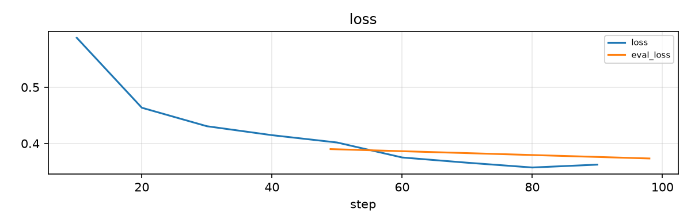
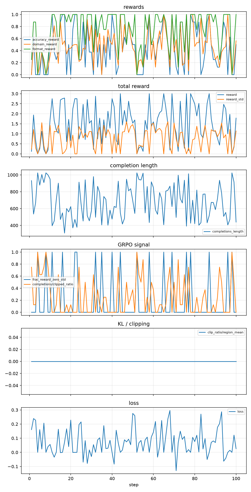

# Resultados · Fase 1 (razonamiento: codificación MedDRA)

Dos alumnos con LoRA, entrenados con las mismas trazas: **Qwen3-0.6B** (primera versión) y
**Qwen3-1.7B** (versión final, la que usa el agente). Profesor de destilación: **Qwen3-4B** en modo
thinking. Entrenado y evaluado en la DGX. Detalle de la tarea y los ficheros en
[`docs/guia/01_razonamiento_rlm.md`](../docs/guia/01_razonamiento_rlm.md); diario en
[`EXPERIMENTS.md`](../EXPERIMENTS.md).

## Dataset

| Partición | Problemas | Notas |
|---|---|---|
| train | 1000 | 76 PT de 18 SOC |
| test | 200 | Disjunto de train por parámetros |
| test OOD | 100 | Cada problema con al menos uno de 14 PT nunca vistos |

Fuente: `reports/phase1_dataset_stats.json`.

## Destilación

| Métrica | Valor |
|---|---|
| Trazas generadas | 1600 (400 problemas × 4) |
| Trazas verificadas | 821 (**51,3 %**) |
| Problemas con al menos una traza correcta | 72 % |
| Aceptación por familia | single 65 % · lack_of_effect 59 % · death 51 % · multi 46 % · diagnosis 37 % |
| Motivos de rechazo | missing 447 · unparseable 120 · not in MedDRA 109 · extra 103 |

Fuente: `rlm/data/sft_traces.stats.json`.

## Qwen3-1.7B · pass@1 (decodificación greedy, 2048 tokens máximos)

SFT con las 821 trazas verificadas; GRPO de 100 pasos desde el adaptador de SFT (completions de
hasta 1024 tokens, ~38 s por paso, 1 h 03 min en un MIG de 16 GB).

| Modelo | Test (200) | OOD (100) | Formato válido (test) | F1 medio (test) | Tokens medios (test) | Sin `<answer>` |
|---|---|---|---|---|---|---|
| Base | 18,5 % | 14 % | 22,5 % | — | 1 290 | 63 |
| + SFT | 51,5 % | 30 % | 86,5 % | 0,67 | 829 | 27 |
| + SFT + GRPO | **56,5 %** | **38 %** | 90,5 % | 0,72 | 733 | 19 |

pass@1 en test por familia:

| Familia | Problemas | Base | SFT | GRPO |
|---|---|---|---|---|
| single | 39 | 36 % | 64 % | **72 %** |
| lack_of_effect | 29 | 28 % | 72 % | 72 % |
| death | 30 | 3 % | 57 % | **67 %** |
| multi | 58 | 16 % | 45 % | 47 % |
| diagnosis | 44 | 11 % | 32 % | **39 %** |

Tipos de error (GRPO): missing 58 · sin respuesta 19 · extra 8 · not in MedDRA 2.

Fuentes: `reports/phase1_eval_base_1.7b.json` (base), `reports/phase1_eval_1.7b.json` (SFT y
GRPO en test), `reports/phase1_eval_ood_grpo_1.7b.json` (GRPO en OOD). OOD de base y SFT:
resúmenes del log de la ejecución (`eval_1.7b.log`; la sesión de la DGX terminó durante el GRPO,
antes de escribir el JSON, y el GRPO se evaluó aparte).

pass@1 en OOD por familia:

| Familia | Problemas | Base | SFT | GRPO |
|---|---|---|---|---|
| single | 17 | 24 % | 41 % | **76 %** |
| multi | 37 | 11 % | 32 % | **43 %** |
| diagnosis | 27 | 15 % | 19 % | 15 % |
| death | 15 | 0 % | 27 % | 20 % |
| lack_of_effect | 4 | 50 % | 50 % | 50 % |
| F1 medio | | 0,32 | 0,47 | **0,58** |
| Formato válido | | 28 % | 83 % | 91 % |
| Sin `<answer>` | | 30 | 17 | 9 |

Tipos de error en OOD (GRPO): missing 50 · sin respuesta 9 · extra 3 · not in MedDRA 0.

### Lectura (1,7B)

- **SFT casi triplica la base** (18,5 % → 51,5 %), y sobre todo enseña a terminar: la base
  razona tanto que en 63 de 200 casos no llega a escribir `<answer>` ni con 2048 tokens; tras SFT
  quedan 27.
- **GRPO suma 5 puntos** (51,5 % → 56,5 %), el mismo salto que con 0,6B, concentrado en las
  familias con reglas (`death` +10, `diagnosis` +7) y en `single`. Vuelve a acortar el
  razonamiento (829 → 733 tokens) y reduce los casos sin respuesta (27 → 19).
- **El tamaño pesa más que el GRPO**: el SFT de 1,7B (51,5 %) ya supera al GRPO de 0,6B (41,5 %).
- **1,7B generaliza bastante mejor que 0,6B**: en OOD el SFT pasa de 14 % a 30 % (con 0,6B, de
  0 % a 10 %). Conserva el 58 % de su acierto en test (30/51,5), frente al 27 % de 0,6B (10/36,5).
  Aun así cae 21 puntos frente al test: parte de lo aprendido son los 76 términos vistos. La base
  apenas cae (18,5 → 14 %) porque no ha visto ninguno; la diferencia que queda es la mezcla de
  familias (el OOD tiene más `multi` y `diagnosis`).
- **GRPO ayuda más fuera de distribución que dentro**: +8 puntos en OOD (30 → 38 %) frente a +5
  en test, y conserva el 67 % de su acierto en test (38/56,5). Con 0,6B, GRPO solo sumaba 2 en
  OOD. La ganancia está en `single` (41 → 76 %) y `multi` (32 → 43 %): con un término nuevo, el
  GRPO lo encuentra más a menudo. No inventa ningún término (`not in MedDRA` 0).
- **Lo que no generaliza son las reglas con términos nuevos**: en OOD, `diagnosis` y `death` no
  mejoran con GRPO (19 → 15 %, 27 → 20 %; 27 y 15 problemas, dentro del ruido). Codificar un
  diagnóstico que nunca ha visto, en vez de sus síntomas, sigue fuera de su alcance.
- Lo que queda: `multi` y `diagnosis` por debajo del 50 %. El error dominante es `missing` (le
  falta un término), no inventar términos: `not in MedDRA` casi desaparece (2).

## Ablaciones de las recompensas de GRPO (Qwen3-1.7B, test)

Cada ablación cambia **una sola cosa** respecto al GRPO final: mismo adaptador SFT de partida,
mismos 100 pasos, mismos datos, misma semilla, misma evaluación (greedy, 2048 tokens).

| Variante | Cambio | pass@1 | F1 medio | Formato | Tokens | missing | extra | not in MedDRA | Sin respuesta |
|---|---|---|---|---|---|---|---|---|---|
| SFT (sin GRPO) | — | 51,5 % | 0,67 | 86,5 % | 829 | 59 | 5 | 6 | 27 |
| **GRPO final** | formato 0,5 + exactitud 2,0 + dominio 0,5 | **56,5 %** | **0,72** | 90,5 % | 733 | 58 | 8 | 2 | 19 |
| Sin recompensa de dominio | peso de `domain_reward` a 0 | 53,0 % | 0,70 | 90,5 % | 703 | 63 | 9 | 3 | 19 |
| Crédito parcial | exactitud = F1 entre conjuntos de PT | 55,0 % | 0,72 | 91 % | 775 | 59 | 8 | 5 | 18 |

pass@1 por familia:

| Familia | Problemas | SFT | GRPO final | Sin dominio | Crédito parcial |
|---|---|---|---|---|---|
| single | 39 | 64 % | **72 %** | 67 % | 67 % |
| lack_of_effect | 29 | 72 % | 72 % | 76 % | **79 %** |
| death | 30 | 57 % | 67 % | **73 %** | 60 % |
| multi | 58 | 45 % | **47 %** | 40 % | 43 % |
| diagnosis | 44 | 32 % | 39 % | 30 % | **41 %** |

Fuentes: `reports/phase1_eval_ablation_nodomain_1.7b.json`,
`reports/phase1_eval_ablation_partial_1.7b.json`.

### Lectura de las ablaciones

- **Quitar la recompensa de dominio cuesta 3,5 puntos** (56,5 → 53,0 %), y la pérdida está en las
  familias difíciles: `diagnosis` 39 → 30 % y `multi` 47 → 40 %. No se explica por términos
  inventados (`not in MedDRA` pasa de 2 a 3): el SFT ya enseñó el vocabulario. La explicación más
  probable es la **señal**: en `diagnosis` y `multi` muchos grupos de 8 respuestas fallan todos, la
  exactitud vale 0 en todas y la ventaja es nula; `domain_reward` sigue distinguiendo entre ellas
  (sinónimo frente a PT exacto, listas demasiado largas) y el modelo sigue aprendiendo en esos
  problemas. Sin ella, ese paso no enseña nada.
- **El crédito parcial no aporta** (55,0 % frente a 56,5 %; F1 0,72 en los dos). Ni siquiera sube el
  F1, que es lo que optimiza, ni reduce los `missing` (59 frente a 58). Probable motivo: con la
  recompensa de dominio la señal ya no es binaria, así que el F1 añade poca información nueva. Se
  mantiene la exactitud estricta, que además coincide con la métrica de evaluación.
- **Cautela**: una ejecución por variante y 200 problemas; el intervalo al 95 % de un pass@1 en
  torno al 55 % es de unos ±7 puntos. Ninguna diferencia de esta tabla es significativa por sí
  sola (ver la prueba de McNemar más abajo); lo consistente es que la configuración final es la mejor de
  las tres y que la recompensa de dominio importa justo en las familias donde la exactitud no da
  señal.

## ¿Son significativas las diferencias? (prueba de McNemar, test, 1,7B)

Prueba exacta de McNemar sobre los mismos 200 problemas: solo cuentan los problemas en los que
los dos modelos discrepan (uno acierta y el otro falla).

| Comparación | Solo acierta el 1.º | Solo acierta el 2.º | p |
|---|---|---|---|
| Base frente a SFT | 5 | 71 | **< 0,001** |
| SFT frente a GRPO final | 11 | 21 | 0,11 |
| Sin dominio frente a GRPO final | 14 | 21 | 0,31 |
| Crédito parcial frente a GRPO final | 13 | 16 | 0,71 |
| SFT frente a sin dominio | 14 | 17 | 0,72 |
| SFT frente a crédito parcial | 10 | 17 | 0,25 |

- **El SFT es una mejora clara y significativa.**
- **El GRPO final mejora al SFT en casi el doble de problemas de los que empeora (21 frente a
  11), pero con p = 0,11 no llega al 5 %**: con 200 problemas, +5 puntos está en el límite de lo
  detectable. Es una tendencia que se repite con 0,6B (+5 también), no una prueba.
- **Las ablaciones no se distinguen estadísticamente del GRPO final ni del SFT.** Lo que sí se ve
  es el orden: solo la configuración final se acerca a la significación frente al SFT.

## Curvas de entrenamiento (1,7B)




**SFT** (2 épocas, 821 trazas): la pérdida de entrenamiento baja de 0,59 a 0,36 y la de
validación de 0,39 a 0,37 entre la primera y la segunda época; la precisión por token pasa de
0,81 a 0,87. La validación casi no mejora en la segunda época: más épocas empezarían a memorizar
las trazas.

**GRPO** (100 pasos, 8 respuestas por problema; medias por tramo, recompensas sin ponderar):

| Pasos | Longitud media | Formato | Exactitud | Dominio | Grupos sin señal |
|---|---|---|---|---|---|
| 1–10 | 893 | 0,39 | 0,16 | 0,21 | 20 % |
| 11–25 | 557 | 0,88 | 0,58 | 0,48 | 27 % |
| 26–50 | 651 | 0,84 | 0,49 | 0,55 | 16 % |
| 51–75 | 758 | 0,68 | 0,42 | 0,45 | 16 % |
| 76–100 | 631 | 0,81 | 0,49 | 0,52 | 20 % |

Fuente: `reports/grpo_1.7b_trainer_state.json`.

- **Lo primero que aprende GRPO es a acortar.** Al principio las respuestas rozan el límite de
  1024 tokens (893 de media): muchas se cortan sin `<answer>`, el formato y la exactitud valen 0
  y la recompensa es baja aunque el SFT ya acierta la mitad. En 15 pasos la longitud cae a 557 y
  formato y exactitud se disparan. Es lo mismo que se ve en la evaluación (829 → 733 tokens y
  menos casos sin respuesta), y explica una parte de la mejora.
- **Después, la exactitud se estanca en torno a 0,45–0,50** con oscilaciones: cada paso ve un
  solo problema distinto, así que la curva mezcla problemas fáciles y difíciles. Entre los pasos
  50 y 75 la longitud vuelve a subir y el formato baja, y se recupera al final: 100 pasos son
  pocos para una tendencia limpia.
- **"Grupos sin señal"** (`frac_reward_zero_std`): fracción de pasos en los que las 8 respuestas
  reciben la misma recompensa total, de modo que la ventaja es nula y el paso no enseña nada. Con
  la recompensa de dominio se queda en el 16–27 %; es el mecanismo con el que explicamos la
  ablación sin dominio (la exactitud sola es binaria y deja más grupos empatados).
- El recorte de PPO no llega a actuar (`clip_ratio` = 0 en los 100 pasos). Tampoco hay KL
  (`--beta 0`, el valor por defecto): lo que impide que el modelo se aleje demasiado del SFT es el
  LoRA, la tasa de aprendizaje y los pocos pasos. El porqué del recorte, en la sección siguiente.

### Qué se entrenó con TRL, qué es `grpo_step.py` y cómo leer la pérdida

**Dos piezas distintas.** El entrenamiento real (`rlm/train_grpo.py`) usa `GRPOTrainer` de TRL
1.13: genera las 8 respuestas, llama a nuestras recompensas, calcula la pérdida y actualiza el
LoRA. `rlm/grpo_step.py` es el mínimo del enunciado "un paso de GRPO a mano": las mismas
operaciones (ventajas, ratio, recorte, KL) sobre tensores, con sus tests, para demostrar que
entendemos lo que hace la librería. **No se usa al entrenar**; nada lo importa salvo los tests.

**Por qué el ratio vale 1 y el recorte no actúa.** ρ = π_nuevo / π_viejo compara el modelo en el
momento de calcular la pérdida con el que escribió las respuestas. TRL hace **una sola
actualización por grupo** (`num_iterations = 1`, el valor por defecto): la pérdida se calcula
antes de cambiar nada, con el mismo modelo que acaba de generar, así que ρ = 1 en todos los
tokens y nunca sale de [0,8; 1,2]. No es por `--batch-size 1`: ese parámetro solo decide cuántas
respuestas pasan a la vez por la GPU; los gradientes de las 8 se acumulan y se hace un único
paso del optimizador, matemáticamente igual que pasarlas juntas. El recorte solo actuaría
reutilizando el mismo grupo para varias actualizaciones (`num_iterations` > 1).

**Por qué aun así aprende.** Con ρ = 1 el objetivo de cada token vale Aᵢ, pero el gradiente no
es cero: la derivada de ρ es la de log π, y queda

    ∇L = −(1/G) Σᵢ Aᵢ · (1/|oᵢ|) Σₜ ∇log π(oᵢ,ₜ)

Aunque las ventajas sumen 0 dentro del grupo, cada Aᵢ multiplica un vector distinto (el de los
tokens de la respuesta i), así que no se cancelan: sube los tokens de las respuestas buenas y baja
los de las malas. En esta configuración GRPO equivale a REINFORCE con la media del grupo como
línea base. Solo es cero si todas las respuestas del grupo empatan (`frac_reward_zero_std`).

**Por qué la pérdida registrada es positiva.** Con la media por respuesta del GRPO original (la
de `grpo_step.py`), el valor de la pérdida con ρ = 1 es −mean(Aᵢ) = 0 siempre. TRL 1.13 usa por
defecto `loss_type = "dapo"`: divide por el total de tokens del grupo, de modo que

    L = −Σᵢ Aᵢ·|oᵢ| / Σᵢ |oᵢ|

y las respuestas largas pesan más. Al principio las peores respuestas son las largas (se cortan a
1 024 tokens sin `<answer>`, recompensa 0, ventaja negativa), así que la pérdida sale positiva
(0,11 de media en los pasos 1–10) y el gradiente empuja con fuerza a acortar: es lo primero que
aprende el modelo. **El valor de la pérdida en GRPO no indica si el modelo aprende**; lo que hay
que mirar son las recompensas y la longitud. Diferencia a tener en cuenta: nuestro paso a mano
implementa la media por respuesta del GRPO original, y el entrenamiento usó la de DAPO.

## Qué mide (y qué no) el conjunto OOD

Codificar exige dos cosas distintas: **seleccionar** qué hay que codificar (las reglas: no la
indicación, no lo negado, el diagnóstico en vez de sus síntomas, la causa y no la muerte) y
**nombrar** cada cosa con su PT ("me sangra la nariz" → `Epistaxis`). El modelo no tiene ningún
diccionario: el vocabulario lo saca de su preentrenamiento (Qwen3 ha leído mucho inglés médico) y
de los 76 PT que vio en el entrenamiento. Los 90 PT de `rlm/meddra.py` solo los usan el
verificador y la recompensa para corregir.

En OOD el vocabulario sí se transfiere (`single` 72 % en test → 76 % en OOD), pero las reglas que
exigen conocimiento clínico del término nuevo no (`diagnosis` 39 → 15 %, `death` 67 → 20 %):
para no codificar los síntomas típicos de un diagnóstico hay que saber cuáles son los síntomas
típicos de *ese* diagnóstico. Lo que generaliza es el procedimiento sencillo, no el criterio
clínico.

**Limitación del subconjunto.** Un término que no está entre nuestros 90 cuenta como fallo
(`not in MedDRA`) aunque exista en el MedDRA real (`Abdominal discomfort`, en el fallo 3). En la
práctica pesa poco (2 casos de 200 en test, 0 en OOD) porque la respuesta esperada siempre está
dentro de los 90; con los ficheros oficiales (`ARCA_MEDDRA_DIR`) el verificador aceptaría todos
los LLT y desaparecerían esos falsos fallos.

## Cinco fallos del GRPO (test, 1,7B)

1. **Sinónimo en vez de PT** (`single`). "Notaba un cosquilleo raro en los dedos, como
   pinchacitos" → predice `Prickling`; el PT es `Paraesthesia`. El razonamiento es correcto (es
   un síntoma, no hay diagnóstico) y falla solo el vocabulario: elige la palabra inglesa
   coloquial. Igual con "no tenía nada de hambre" → `Lack of appetite` en vez de `Decreased
   appetite`. Es un patrón frecuente dentro de los 58 `missing`.
2. **La regla del diagnóstico requiere saber medicina** (`diagnosis`). "Boca seca … sudaba
   muchísimo … me diagnosticaron un infarto de miocardio" → `Xerostomia; Hyperhidrosis;
   Myocardial infarction`. La regla dice que los síntomas propios del diagnóstico no se
   codifican; para eso hay que saber que la sudoración es típica del infarto y la boca seca no. El
   modelo aplica la regla al pie de la letra ("el diagnóstico se codifica") pero no sabe qué
   síntomas son "típicos", y añade uno de más.
3. **Regla de la muerte invertida** (`death`). "Retortijones y dolor de tripa … falleció a causa
   de un infarto de miocardio" → `Chest pain; Abdominal discomfort`. Esperado: `Abdominal pain;
   Myocardial infarction`. En el razonamiento dice "el infarto es la causa de la muerte, así que
   no se codifica la muerte" (bien) y luego tampoco codifica el infarto (mal), y en su lugar
   inventa un "dolor torácico" que el texto no menciona, asociado al infarto. (Por qué la regla:
   en el ICSR la muerte ya se registra como desenlace y criterio de gravedad; codificar `Death`
   como reacción perdería lo útil para detectar señales, que es *de qué* murió.)
4. **Bucles de repetición sin respuesta** (19 casos, 13 en `diagnosis`). Ante una duda, el modelo
   repite la misma frase hasta agotar los 2048 tokens: "But the son is the one who reported it,
   so the adverse event is the weight gain. But the son is the one who called the center…", o
   "Therefore, the answer is the two diagnoses" decenas de veces; en un caso, una tira de ceros.
   La decodificación greedy sin penalización de repetición lo favorece; GRPO los redujo (27 → 19)
   pero no los elimina.
5. **Síntoma alucinado** (`single`). "Tuvo retortijones y dolor de tripa" con lorazepam →
   `Tremor; Abdominal pain`. El temblor no aparece en la notificación; el modelo lo añade porque es
   una reacción conocida de las benzodiacepinas. Es el riesgo de un modelo que "sabe"
   farmacología: codifica lo esperable en vez de lo notificado.

Qué sugieren: (1) se arreglaría con una herramienta de búsqueda en MedDRA (sinónimo → PT), que es
justo lo que hace la recompensa de dominio durante el entrenamiento pero no está en inferencia;
(4) con una penalización de repetición o una recompensa por longitud; (2) y (3) son los límites
de un modelo de 1,7B, coherentes con que `diagnosis` y `death` no generalizan en OOD.

## Qwen3-0.6B · pass@1 (decodificación greedy, 1024 tokens máximos)

| Modelo | Test (200) | OOD (100) | Formato válido (test) | F1 medio (test) | Tokens medios (test) |
|---|---|---|---|---|---|
| Base | 7,5 % | 0 % | 61 % | 0,27 | 419 |
| + SFT | 36,5 % | 10 % | 73,5 % | 0,53 | 652 |
| + SFT + GRPO | **41,5 %** | **12 %** | 84 % | 0,60 | 586 |

pass@1 en test por familia:

| Familia | Base | SFT | GRPO |
|---|---|---|---|
| single | 15 % | 59 % | 64 % |
| multi | 10 % | 24 % | 28 % |
| diagnosis | 2 % | 20 % | 32 % |
| death | 3 % | 27 % | 33 % |
| lack_of_effect | 3 % | 66 % | 62 % |

Fuentes: `reports/phase1_eval.json` (test), `reports/phase1_eval_ood.json` (OOD),
`reports/phase1_eval_base.json` (línea base aparte: 5 %, ver la nota de no determinismo).

### Lectura (0,6B)

- SFT aporta casi todo el salto (+29 puntos); GRPO añade +5 en test y +2 en OOD, sobre todo en
  las familias con reglas (`diagnosis`, `death`).
- **Muchos fallos son truncados, no errores**: las 53 respuestas sin `<answer>` de SFT y las 32
  de GRPO llegaron al límite de 1024 tokens (26,5 % y 16 % del test). GRPO razona más corto
  (652 → 586 tokens), y eso explica parte de su mejora.
- El OOD es muy bajo para todos: el modelo no generaliza a términos que no ha visto.
- La línea base dio 5 % y 7,5 % en dos ejecuciones greedy: no determinismo de bf16 con padding.

## El mismo modelo, servido de uno en uno (como la API)

La evaluación de arriba genera en lotes de 16 preguntas con relleno a la izquierda. La API
(`/reasoning`) genera una pregunta cada vez. Con decodificación greedy debería dar lo mismo, pero
en bf16 el tamaño del lote cambia mínimamente los cálculos y, cuando dos tokens casi empatan,
cambia cuál se elige. Medido en la DGX con el mismo adaptador, el mismo test y `--batch-size 1`:

| | Lotes de 16 | Lotes de 1 (como la API) |
|---|---|---|
| **pass@1** | **56,5 %** | **53,5 %** |
| Formato válido | 90,5 % | 91 % |
| F1 medio | 0,72 | 0,71 |
| Tokens medios | 733 | 729 |
| `single` / `multi` / `diagnosis` / `death` / `lack_of_effect` | 72 / 47 / 39 / 67 / 72 % | 69 / 40 / 32 / 70 / 76 % |

Fuente: `reports/phase1_eval_1.7b_batch1.json`.

- **Es el mismo modelo**: formato, longitud y F1 iguales; solo cambia qué problemas concretos
  acierta, y unas familias suben mientras otras bajan.
- **3 puntos de diferencia sin cambiar nada del modelo.** Es del mismo tamaño que la diferencia
  entre el GRPO final y la ablación sin recompensa de dominio (56,5 frente a 53,0 %). Confirma con
  un dato propio lo que decía McNemar: con 200 problemas, diferencias de 3 puntos no se separan
  del ruido de evaluación.
- **Qué esperar de la API**: entre el 53 y el 56 % en el test. Informamos 56,5 % (la evaluación
  completa, en lotes) y este 53,5 % como lo que da el mismo modelo servido de uno en uno.

    uv run python -u -m rlm.evaluate --data rlm/data/test.jsonl --model Qwen/Qwen3-1.7B \
        --max-new-tokens 2048 --batch-size 1 \
        --adapters grpo=$HOME/clusters/dgx/arca_weights/grpo_lora_1.7b \
        --out reports/phase1_eval_1.7b_batch1.json

## Pendiente

Nada de entrenamiento. Posibles extensiones: recompensa por longitud o penalización de
repetición contra los bucles (fallo 4), y una herramienta de búsqueda en MedDRA para los
sinónimos (fallo 1).

## Reproducir

```bash
make rlm-data && make rlm-distill && make rlm-sft && make rlm-grpo && make rlm-eval   # DGX
```
